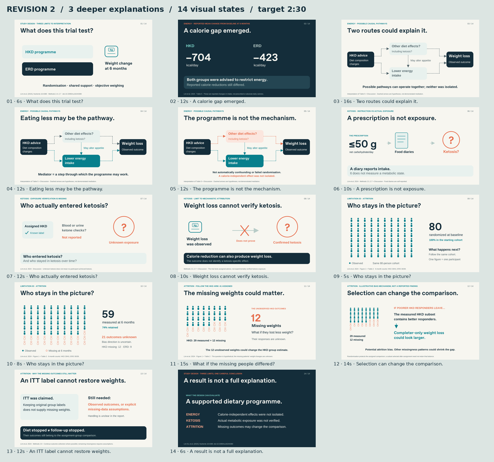

# Revision 2 — three limitations explained in depth

- [Download animated PowerPoint](Study_Design_Critique_v2_Animated.pptx)
- [View static PDF](Study_Design_Critique_v2_Static.pdf)
- [View storyboard](Storyboard_v2.png)
- [Presenter guide and 285-word speaker script](Presenter_Guide_and_Script_v2.md)
- [Full scientific explanation](Scientific_Explanation_v2.md)
- [Validation summary](Validation_v2.json)

This revision uses 14 visual states to explain three issues: the calorie gap and causal pathways, unverified ketosis, and attrition. Standalone improvement and generalisability sections are removed. The 80→59 cohort transition is preserved; it now leads into a closer look at the 12 unobserved HKD outcomes and a conditional illustration of attrition bias. The example does not assert that missing participants were actually poorer responders.

Six Morph transitions support persistent causal diagrams, exposure-state changes, the cohort change and the HKD subset focus. Pacing is click-controlled, with no automatic slide advance. Open in a current desktop Microsoft PowerPoint and use Slide Show. The target duration is approximately 2:30. Name/UID space is omitted as requested.

Layout and animation-package checks passed with zero errors or warnings. Actual Microsoft PowerPoint playback was not tested in the Linux authoring environment. Static PDF/PNG previews come from the same SVG design sources.

Source: Lim et al. (2024), *Nutrients*, 16, 4380. https://doi.org/10.3390/nu16244380

