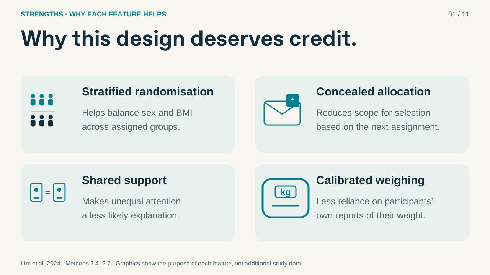
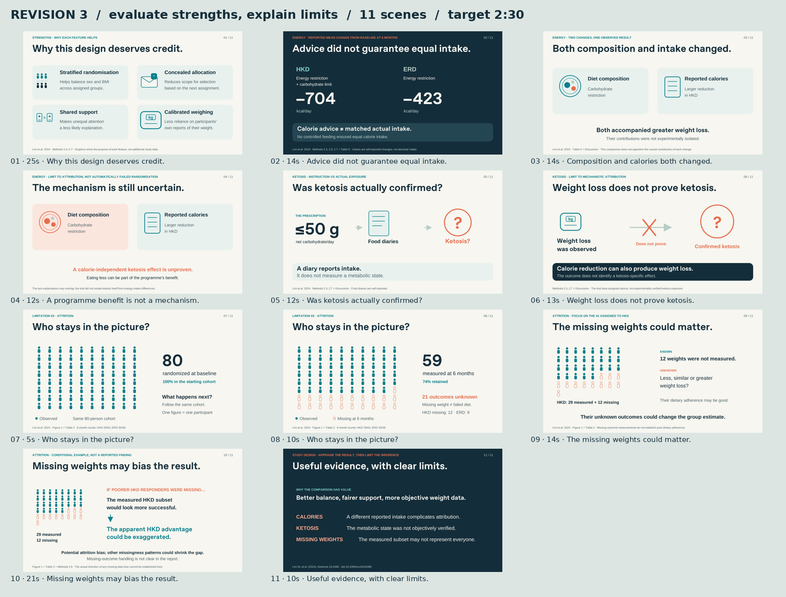

# Revision 3 — illustrated strengths and clearer critique

- [Download animated PowerPoint](Study_Design_Critique_v3_Animated.pptx)
- [View static PDF](Study_Design_Critique_v3_Static.pdf)
- [Preview the revised strengths slide](Strengths_Preview_v3.png)
- [View storyboard](Storyboard_v3.png)
- [Presenter guide and 285-word script](Presenter_Guide_and_Script_v3.md)
- [Validation summary](Validation_v3.json)

The opening now evaluates four strengths. Every feature has a graphic and a direct explanation of why it helps: stratified randomisation, concealed allocation, shared support and calibrated weighing. The complex branching causal map is replaced with a simpler comparison of changed diet composition and reported energy intake. The ketosis limitation remains; the independent ITT page and term are removed. Missing measurement is explicitly distinguished from poor dietary adherence. The liked 80→59 cohort animation is retained.

11 scenes, target approximately 2:30, embedded English speaker notes, 17 native object effects and four deterministic Morph state changes. Click-controlled, with no automatic slide advance. Use a current desktop Microsoft PowerPoint and start Slide Show. No name/UID placeholder or narration is embedded.

Layout and animation-package checks passed with zero errors or warnings. Actual Microsoft PowerPoint playback was not tested in the Linux environment. The PDF and PNG previews come from the same design sources.

Source: Lim et al. (2024), Nutrients 16:4380. https://doi.org/10.3390/nu16244380

## Revised strengths opening

## Full storyboard

