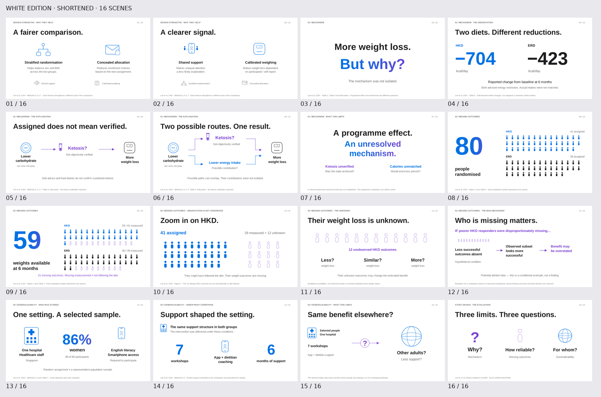

# White Keynote edition — shortened

[Download animated PPTX](Study_Design_Critique_White_Short_Animated.pptx) · [PDF](Study_Design_Critique_White_Short_Static.pdf) · [Storyboard](Storyboard_Short.png)

The seven requested captions are removed, as is original slide 13. The original final slide was slide 17 (referred to as slide 18 in the request); the exact matching concluding sentence was removed. The deck now contains 16 slides. Subsequent slides and page numbers are renumbered, and continuing Morph references are updated. Remaining layouts and animation choreography are preserved. The original white version remains in [v4-keynote-white](../v4-keynote-white/).

All 16 scene sources passed layout checks without errors or warnings. The native package passed postflight; 10 Morph transitions remain, with automatic slide advance off. Deleted strings and the removed slide were checked in the exported native slide XML. Speaker notes are retained for the remaining scenes. Desktop playback is not available in this environment.

