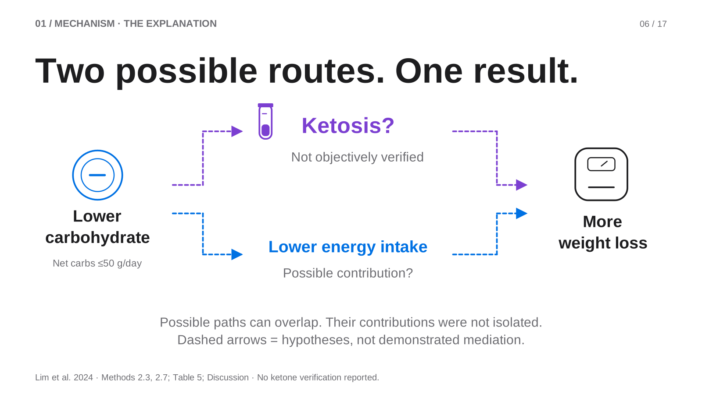
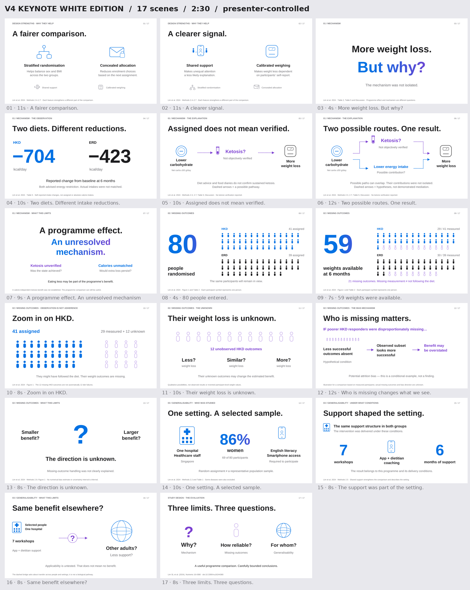

# v4 Keynote White Edition

White-background colour variant of the black Keynote edition. Text, layout, all 10 Morph transitions, 28 object effects, 17 speaker notes and manual pacing are preserved. Blue and purple accents are darkened for contrast on white.

[**Download the white animated PPTX**](https://github.com/diqinglang321/diqinglang/raw/refs/heads/main/presentations/weight-loss-study-design/v4-keynote-white/Study_Design_Critique_v4_Keynote_White_Animated.pptx) · [PDF](Study_Design_Critique_v4_Keynote_White_Static.pdf) · [Complete pack](Keynote_White_Edition_Pack.zip) · [Black edition](../v4-keynote/)

The pack includes a self-contained Interactive_Preview.html, English script and PDF. Extract the HTML and open it in a browser to control advancement and transition speed. The HTML is a separate browser renderer, not a recording of native PowerPoint.

Use desktop PowerPoint or WPS for PPTX animations. Canva import does not preserve the same native animation behaviour. Desktop playback is not available in this environment.

All 17 native slides were compared with the black version: animation trees, transitions, geometry, positions, object names, visible text and embedded notes are identical. All backgrounds resolve to white. See Colour_Only_Verification.json.

Source: Lim SL et al. (2024), Nutrients 16:4380. https://doi.org/10.3390/nu16244380

Generated using [PPT Master](https://github.com/hugohe3/ppt-master).
