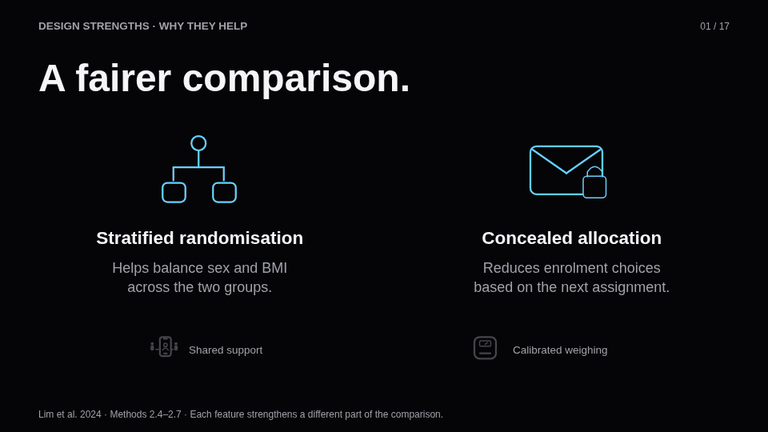
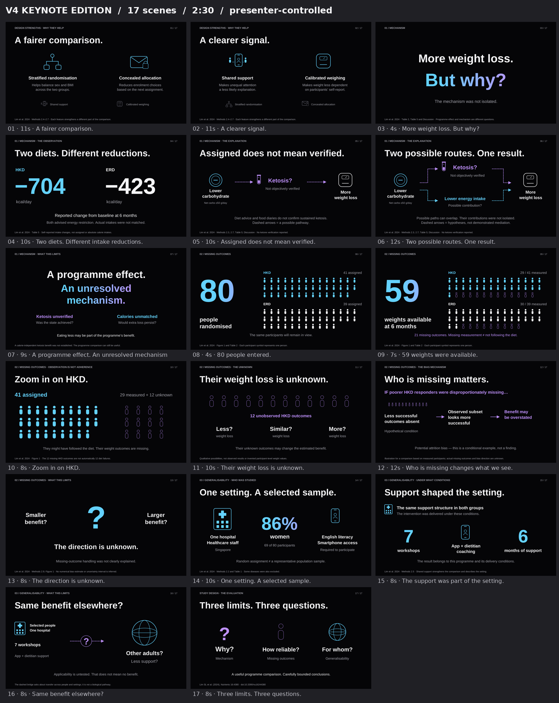

# v4 Keynote Edition

A new visual and motion treatment of the approved v4 critique: four illustrated strengths, then mechanism, missing outcomes and generalisability. All slide text and narration are English. Target: 2:30.

[**Download the animated PowerPoint**](https://github.com/diqinglang321/diqinglang/raw/refs/heads/main/presentations/weight-loss-study-design/v4-keynote/Study_Design_Critique_v4_Keynote_Animated.pptx) · [Complete download pack](https://github.com/diqinglang321/diqinglang/raw/refs/heads/main/presentations/weight-loss-study-design/v4-keynote/Keynote_Edition_Pack.zip) · [Static PDF](Study_Design_Critique_v4_Keynote_Static.pdf) · [Presenter guide and English script](Presenter_Guide_and_Script.md)

## Motion preview

[MP4 preview](Motion_Preview.mp4). These samples use the browser renderer; they are not recordings of native PowerPoint playback.

## Presenter control

The PowerPoint has 17 visual states, 10 deterministic Morph transitions, 28 coordinated object effects, and 17 embedded speaker notes. Automatic slide advance is off. One click/Right Arrow advances to the next state, followed by a short coordinated build. You control the speaking time between states. The sequence preserves every participant's identity through 80→59 and then focuses on the 12 unobserved HKD outcomes.

Open the PPTX in current desktop PowerPoint, or test it in your WPS version. Canva import does not preserve the same native animation behaviour.

The download pack also contains **Interactive_Preview.html**. Extract it and open it in your browser for a manual presentation preview, with slow/normal/fast motion, back/next controls, a slide selector and the English script. It is self-contained and needs no internet connection.

## Visual overview

## Checks and limitations

All 17 scene sources passed the layout gate without errors or warnings; the PPTX passed native package postflight. Exact cohort counts, Morph identities, notes and manual advancement were checked. The browser preview passed navigation, keyboard, speed and script controls across 17 scenes in Chromium. Desktop PowerPoint/WPS playback is not available in this Linux environment; please rehearse with your presentation application.

No new statistical tests, individual weight data or imputed missing values were invented. Poor-response missingness is a clearly labelled hypothetical example. The original [v4](../v4/) remains available.

Source: Lim SL et al. (2024), *Nutrients*, 16:4380. https://doi.org/10.3390/nu16244380

Native PPTX generated with [PPT Master](https://github.com/hugohe3/ppt-master). Original design inspired by restrained product presentations; no Apple affiliation.
