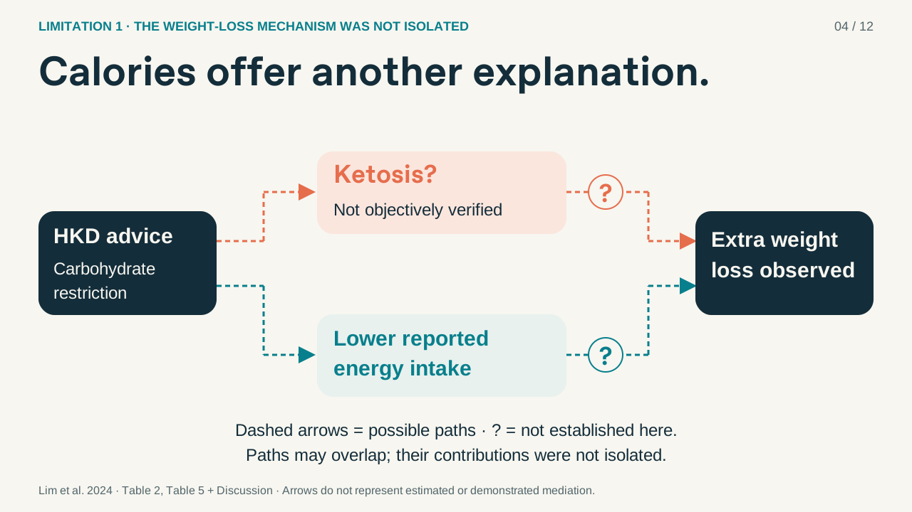
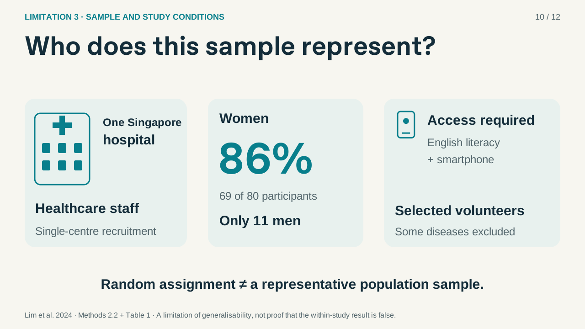
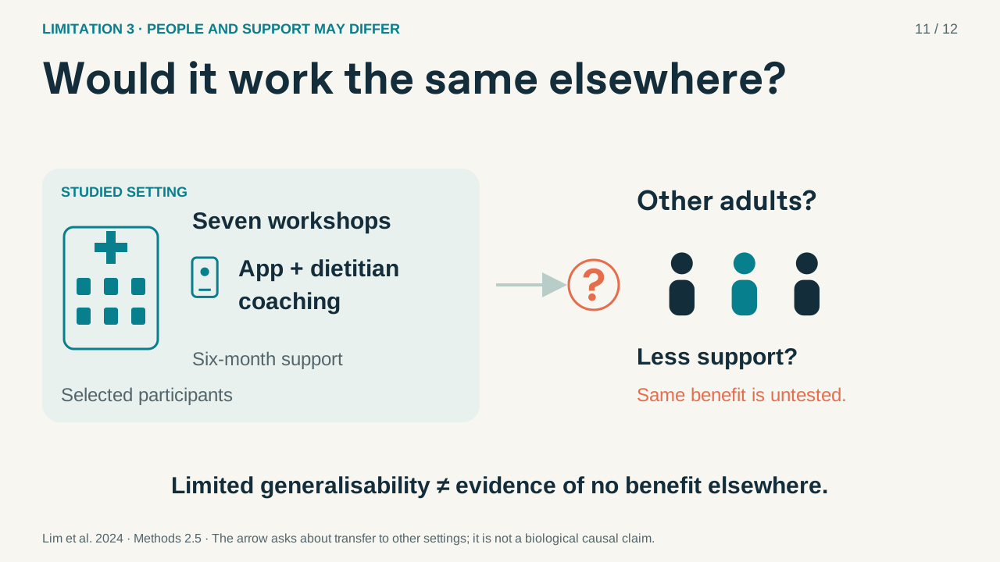

# Revision 4 — three distinct limitations

- [Download animated PowerPoint](Study_Design_Critique_v4_Animated.pptx)
- [View static PDF](Study_Design_Critique_v4_Static.pdf)
- [Mechanism graphic preview](Mechanism_Preview_v4.png)
- [Population graphic preview](Population_Preview_v4.png)
- [Study-context graphic preview](Context_Preview_v4.png)
- [Full storyboard](Storyboard_v4.png)
- [Presenter guide and 294-word script](Presenter_Guide_and_Script_v4.md)
- [Validation summary](Validation_v4.json)

## Main argument

1. **The weight-loss mechanism was not isolated.** Calorie-intake differences and unverified ketosis are combined as two evidence gaps supporting one main limitation. Progressive dashed arrows and question marks show possible routes without claiming demonstrated causality.
2. **Missing outcomes may affect the estimated benefit.** The liked 80→59 transition is retained, followed by an HKD-specific focus and a conditional illustration of potential attrition bias. Missing measurement is not treated as failed adherence.
3. **Sample and study conditions limit generalisability.** New hospital, population, smartphone, coaching and globe graphics explain the difference between random assignment within a selected sample and applicability beyond similar participants and structured support.

The illustrated strengths appraisal remains. There is no independent ITT or improvements page. English content; 12 visual scenes; target approximately 2:30; 294-word embedded script; 25 native object effects and four Morph state changes. Click-controlled with no automatic slide advance. Use a current desktop Microsoft PowerPoint and start Slide Show.

Layout and animation-package checks passed with zero errors or warnings. Actual desktop PowerPoint playback was not tested in the Linux environment. The PDF/PNG previews come from the same design sources. Earlier revisions are preserved in the parent folder.

Source: Lim et al. (2024), Nutrients 16:4380. https://doi.org/10.3390/nu16244380

## Mechanism: possible paths, not proven mediation

## Generalisability: people and conditions

